<div align="center">

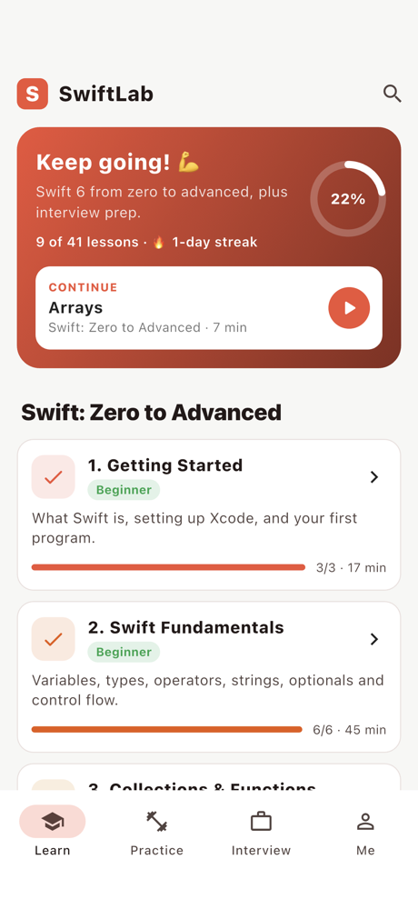

# SwiftLab

**Learn Swift 6 from zero to advanced, then get interview-ready, all offline on your phone.**

41 lessons with highlighted Swift code and 88 quiz questions, plus **62 interview questions with model answers**
and a flashcard drill. Built with Flutter for iOS and Android.


</div>

---

## Screenshots

<table>
  <tr>
    <td align="center"><br><sub><b>Learning path</b></sub></td>
    <td align="center">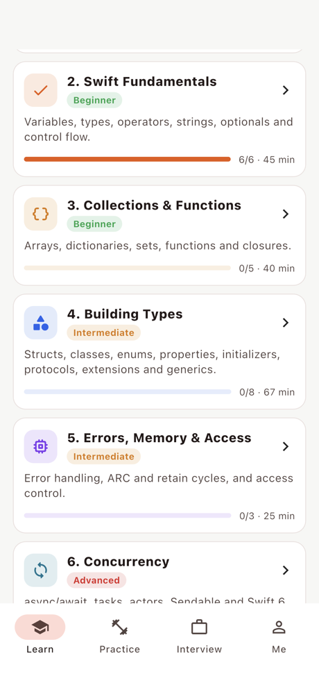<br><sub><b>Modules &amp; progress</b></sub></td>
    <td align="center">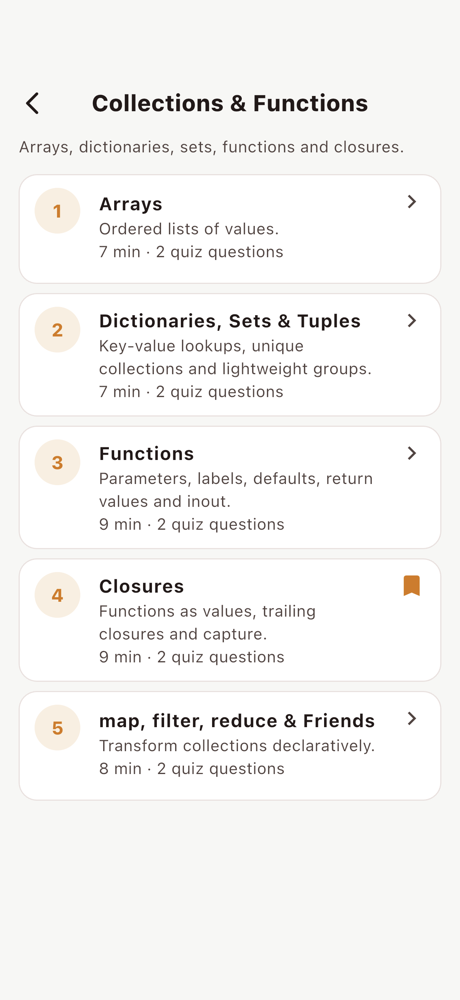<br><sub><b>Module lessons</b></sub></td>
    <td align="center">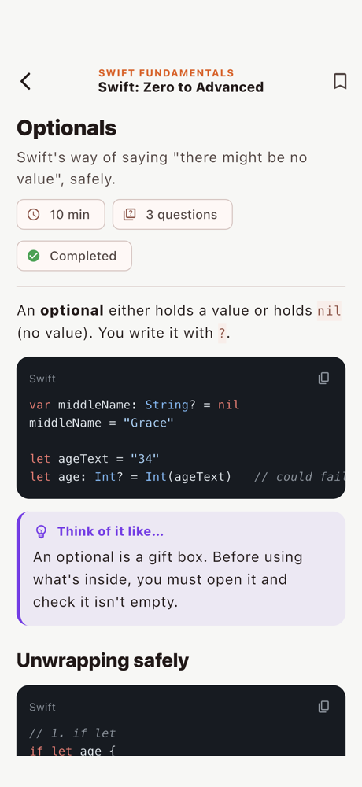<br><sub><b>Lesson</b></sub></td>
  </tr>
  <tr>
    <td align="center">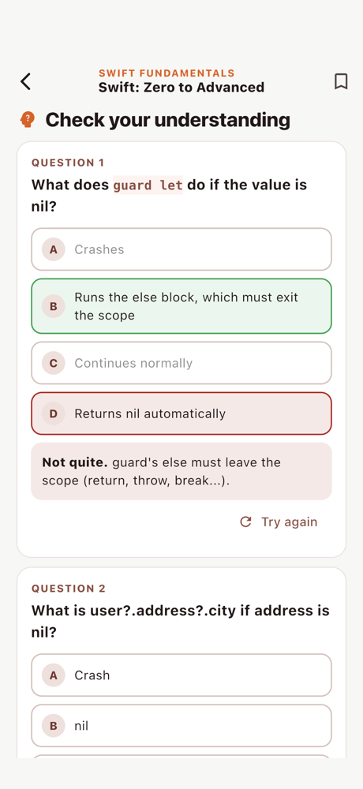<br><sub><b>End-of-lesson quiz</b></sub></td>
    <td align="center">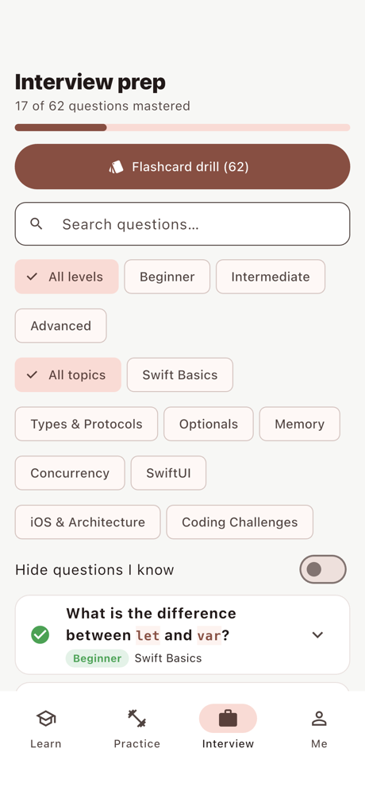<br><sub><b>Interview prep</b></sub></td>
    <td align="center">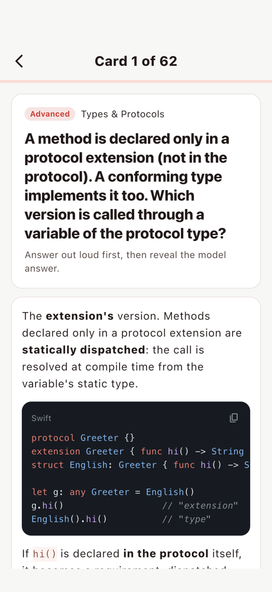<br><sub><b>Flashcard drill</b></sub></td>
    <td align="center">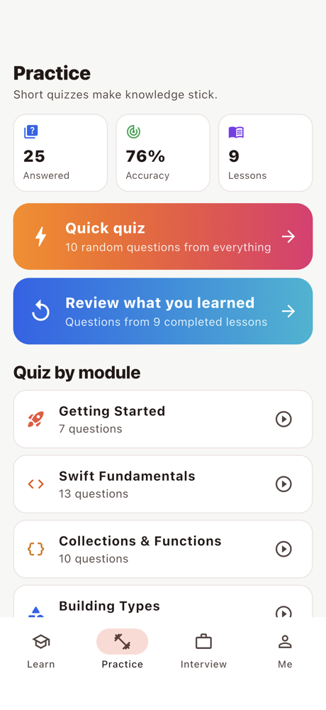<br><sub><b>Practice</b></sub></td>
  </tr>
  <tr>
    <td align="center">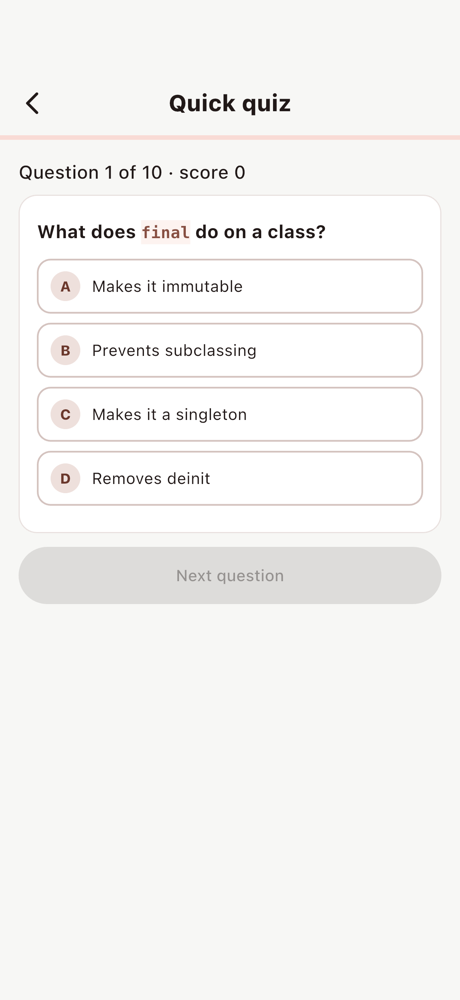<br><sub><b>Quick quiz</b></sub></td>
    <td align="center">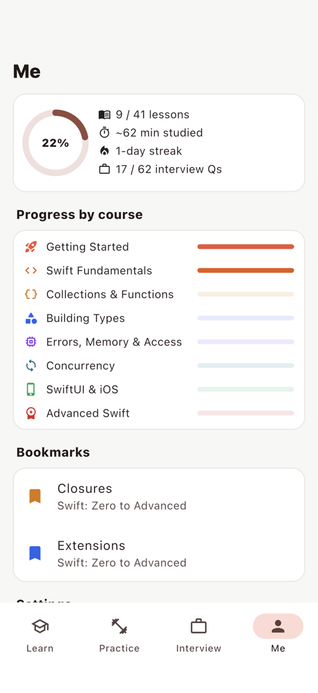<br><sub><b>Progress &amp; settings</b></sub></td>
    <td align="center">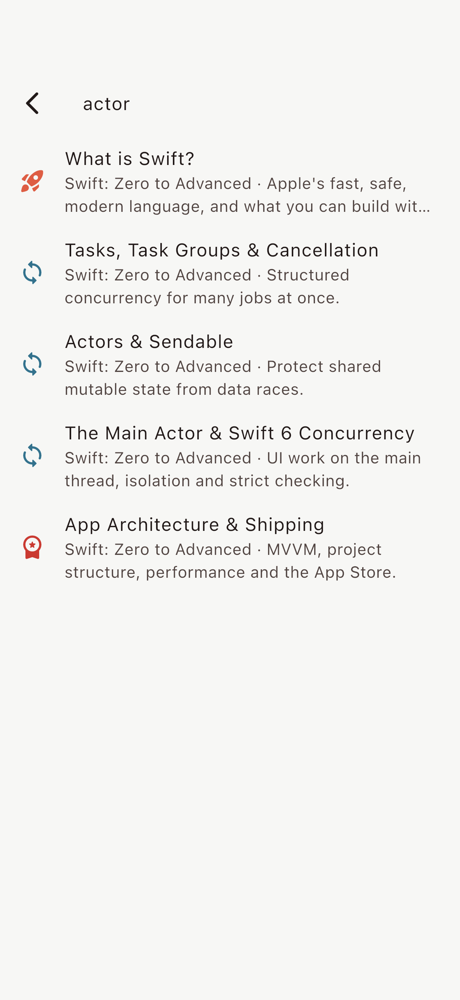<br><sub><b>Search</b></sub></td>
    <td align="center">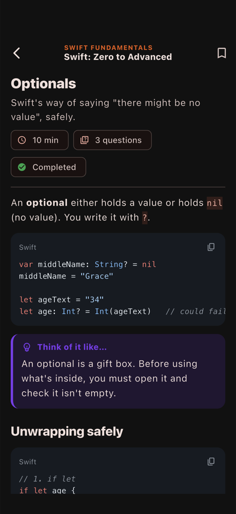<br><sub><b>Dark mode</b></sub></td>
  </tr>
</table>

---

## Curriculum: *Swift: Zero to Advanced*

41 lessons · 88 quiz questions · about 5½ hours of reading

| # | Module | Level | Lessons |
|---|---|---|---|
| 1 | Getting Started | Beginner | What is Swift? · Setting Up: Xcode & Playgrounds · Your First Swift Program |
| 2 | Swift Fundamentals | Beginner | Variables & Constants · Basic Types & Type Safety · Operators · Strings & Characters · Optionals · Control Flow |
| 3 | Collections & Functions | Beginner | Arrays · Dictionaries, Sets & Tuples · Functions · Closures · map, filter, reduce & Friends |
| 4 | Building Types | Intermediate | Structs · Classes & Inheritance · Enums · Properties: Computed, Observers & Lazy · Initializers · Protocols · Extensions · Generics |
| 5 | Errors, Memory & Access | Intermediate | Error Handling · Memory & ARC · Access Control |
| 6 | Concurrency | Advanced | async / await · Tasks, Task Groups & Cancellation · Actors & Sendable · The Main Actor & Swift 6 Concurrency |
| 7 | SwiftUI & iOS | Intermediate | SwiftUI Basics · State & Bindings · Observation: @Observable Models · Lists & Navigation · Networking & Codable · Saving Data with SwiftData |
| 8 | Advanced Swift | Advanced | Associated Types & Protocol-Oriented Design · Property Wrappers & Result Builders · Macros · Ownership & Noncopyable Types · Testing with Swift Testing · App Architecture & Shipping |

## Interview prep: 62 questions with model answers

| Category | Qs | | Level | Qs |
|---|---|---|---|---|
| Types & Protocols | 14 | | Beginner | 23 |
| Swift Basics | 11 | | Intermediate | 25 |
| Concurrency | 8 | | Advanced | 14 |
| iOS & Architecture | 8 | | | |
| SwiftUI | 6 | | | |
| Coding Challenges | 6 | | | |
| Memory | 5 | | | |
| Optionals | 4 | | | |

Filter by level and topic, search, expand a question to read the model answer (with code), mark it **I know this**,
hide the ones you've mastered, or run a shuffled **flashcard drill**: answer out loud, reveal, and score yourself.

## Features

- **Learning path** with a *Continue* card, progress ring and daily **streak**
- **Lessons** with Swift **syntax highlighting**, copyable code, tables and *Think of it like…* / tip / warning callouts
- **Quizzes** after every lesson with an explanation for each answer
- **Practice:** a *Quick quiz* from everything or *Review* from completed lessons, with answered/accuracy stats
- **Interview tab:** filters, search, mastered tracking and flashcard drills
- **Me:** progress per module, minutes studied, bookmarks, theme (System/Light/Dark) and text size
- **Search** across all lessons
- **Fully offline:** all content ships as app assets, and progress is saved on the device

---

## Getting started

### Prerequisites

- [Flutter](https://docs.flutter.dev/get-started/install) **3.47+** (Dart 3.13+)
- Xcode (iOS) and/or Android SDK (Android)

### Run it

```bash
git clone https://github.com/tejHacks/swfit-lab.git swift_lab
cd swift_lab
flutter pub get
flutter run
```

### Build a release

```bash
flutter build apk --release --split-per-abi   # Android APKs
flutter build appbundle --release             # Play Store bundle
flutter build ipa --release                   # iOS (signing required)
```

### Test

```bash
flutter test
```

The tests parse every lesson and quiz, exercise the Markdown parser, start the app, lay out **every lesson and every
interview answer on a small 360×740 phone** (lessons at 100% and 130% text) with no overflow, and drive the interview
tab: filter, reveal, mark known and flashcards.

---

## Editing content

### Lessons

Lessons live in `tool/content/swift_*.md` as bundles of `=== FILE: slug.md ===` sections. Each one has front matter
(`title`, `summary`, `minutes`), Markdown, `:::tip` / `:::note` / `:::warning` / `:::analogy` callouts and a fenced
` ```quiz ` JSON block:

```json
[{"q": "What does `?` after a type mean?", "options": ["Optional", "Throws", "Generic", "Async"],
  "answer": 0, "why": "String? can hold a String or nil."}]
```

Rebuild and validate:

```bash
python3 tool/build_lessons.py tool/content assets/lessons
```

### Interview questions

Questions live in `tool/interview.md`:

```markdown
=== Q: let-vs-var | Swift Basics | beginner
What is the difference between `let` and `var`?
---
`let` declares a **constant**… (Markdown answer, code blocks welcome)
```

Rebuild and validate (unique ids, valid level, non-empty answers, balanced code fences):

```bash
python3 tool/build_interview.py tool/interview.md assets/interview/questions.json
```

---

## Project structure

```
lib/
├── main.dart                 # Loads content + progress, theme, text scale
├── config.dart               # SwiftLab name, Swift-orange brand, course list, interview asset
├── content/                  # Repository, Markdown parser, models
├── state/progress.dart       # Completed, bookmarks, known questions, streak, accuracy, settings
└── ui/                       # Learn, Lesson, Practice, Interview, Search, Me, code view, quiz card
assets/
├── lessons/swift/            # Generated lessons + curriculum.json
└── interview/questions.json  # Generated interview questions
tool/
├── content/swift_{1,2,3}.md  # Lesson sources
├── interview.md              # Interview sources
├── build_lessons.py
└── build_interview.py
```

SwiftLab shares its engine with **[LaravelLab](https://github.com/tejHacks/laravel_lab)**. Only `lib/config.dart` and
the content differ, so the same code can power a course app for any language.

---

## License

This project is currently unlicensed. All rights reserved by the author.
